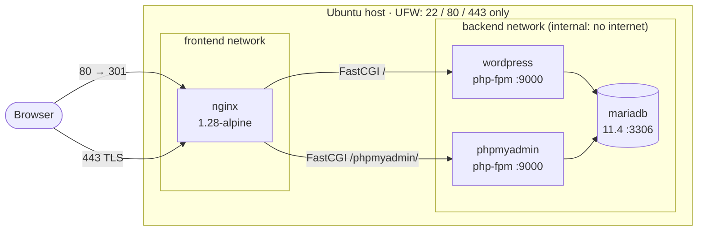

# cloud-1 🌩️

Automated deployment of Inception on a remote server.

> "There is no cloud it's just someone else's computer"

One Ansible command turns a fresh Ubuntu 22.04 host (SSH and Python only) into a
working WordPress site over HTTPS, with phpMyAdmin and MariaDB. Each service runs
in its own container, data survives reboots, and the same playbook can target
several servers in parallel.

---

## Table of contents

- [Architecture](#architecture)
- [Repository layout](#repository-layout)
- [Requirements](#requirements)
- [Quick start](#quick-start)
- [Configuration and secrets](#configuration-and-secrets)
- [How the deployment works](#how-the-deployment-works)
- [Operations](#operations)
- [Security](#security)
- [Persistence and reboots](#persistence-and-reboots)
- [Idempotency](#idempotency)
- [Design decisions](#design-decisions)
- [Troubleshooting](#troubleshooting)
- [Subject checklist](#subject-checklist)
- [References](#references)

---

## Architecture



| Container    | Image                             | Role                                           | Networks            | Exposed to host |
|--------------|-----------------------------------|------------------------------------------------|---------------------|-----------------|
| `nginx`      | `nginx:1.28-alpine`               | TLS termination, static files, URL routing     | frontend            | `80`, `443`     |
| `wordpress`  | `wordpress:6.8-php8.3-fpm-alpine` | Runs WordPress PHP (php-fpm)                   | frontend, backend   | none            |
| `phpmyadmin` | `phpmyadmin:5.2.3-fpm-alpine`     | Database admin UI (php-fpm)                    | frontend, backend   | none            |
| `mariadb`    | `mariadb:11.4`                    | SQL database                                   | backend             | none            |
| `wpcli`      | `wordpress:cli-php8.3`            | One-off job: installs WordPress, creates users | backend             | none            |

One process per container: nginx serves HTTP only, and PHP runs in the php-fpm
containers it talks to over FastCGI. `wpcli` sits behind the `setup` Compose
profile, so it only runs when Ansible calls it and is removed when it finishes
(`--rm`).

### URL routing

| Request                         | Handled by                                         |
|---------------------------------|----------------------------------------------------|
| `http://<domain>/*`             | `301` redirect to HTTPS                            |
| `https://<domain>/phpmyadmin`   | `301` to `/phpmyadmin/`                            |
| `https://<domain>/phpmyadmin/*` | `.php` → `phpmyadmin:9000`, static files → nginx  |
| `https://<domain>/*`            | `.php` → `wordpress:9000`, pretty permalinks       |
| Hidden files (`/.git`, `/.htaccess`, …) | `403` (except `/.well-known`)              |

---

## Repository layout

```text
42adv-cloud-1/
├── README.md
├── intro/                      # Ansible warm-up exercises (not part of the deployment)
└── cloud-1/
    ├── inventory.ini           # Target hosts, group [cloud]
    ├── playbook.yml            # Deploys the whole stack
    ├── clean.yml               # Tears it down
    ├── requirements.yml        # Ansible Galaxy collections
    ├── group_vars/all/
    │   ├── vars.yml            # Non-secret variables (app_dir)
    │   └── vault.yml           # Secrets, encrypted with Ansible Vault
    ├── app/                    # Copied as-is to the server (app_dir)
    │   ├── docker-compose.yml
    │   ├── nginx/default.conf.template
    │   └── wordpress/wp-setup.sh
    └── roles/
        ├── firewall/           # UFW: allow 22/80/443, deny the rest
        ├── docker/             # Docker Engine + Compose plugin, started at boot
        ├── files/              # Copies app/ and renders .env from the Vault
        ├── mariadb/            # Starts the database, waits for it to be healthy
        ├── wordpress/          # Starts WordPress, runs wp-cli setup once
        ├── phpmyadmin/         # Starts phpMyAdmin
        └── nginx/              # Self-signed TLS cert, starts nginx, restart handler
```

---

## Requirements

**Control node** (the machine you run Ansible from)

- Python 3 and Ansible (`ansible-core` 2.15+)
- Galaxy collections `community.docker` and `community.general`
- SSH access to the targets with a key
- The Vault password

**Managed nodes** (the servers)

- Ubuntu 22.04 LTS or similar
- An SSH daemon and `python3`
- A user with `sudo` rights
- Cloud firewall / security group open on **22, 80, 443** only

Everything else (Docker, Compose, UFW, images, certificates) is installed by the playbook.

---

## Quick start

```bash
# 1. Get the code
git clone <repo-url> 42adv-cloud-1
cd 42adv-cloud-1/cloud-1

# 2. Install the Ansible collections
ansible-galaxy collection install -r requirements.yml

# 3. Declare your servers
$EDITOR inventory.ini

# 4. Check connectivity
ansible -i inventory.ini cloud -m ping

# 5. Deploy
ansible-playbook -i inventory.ini playbook.yml --ask-vault-pass
```

Then open `https://<DOMAIN_NAME>/` for WordPress and `https://<DOMAIN_NAME>/phpmyadmin/`
for phpMyAdmin. The certificate is self-signed, so the browser will show a warning
the first time.

### Inventory

```ini
[cloud]
; Remote server (AWS, Azure, Scaleway, …)
203.0.113.10 ansible_user=ubuntu ansible_ssh_private_key_file=~/.ssh/id_ed25519

; Local VM / testing on the control node itself
; localhost ansible_user=<login> ansible_connection=local ansible_python_interpreter=/usr/bin/python3
```

Add one line per server to deploy to several hosts at once. Ansible runs against
them in parallel (5 by default, change it with `-f <forks>`).

---

## Configuration and secrets

No secret is written in plain text in the repository. All credentials live in
`group_vars/all/vault.yml`, encrypted with **Ansible Vault (AES-256)**. At deploy
time the `files` role renders them into `<app_dir>/.env` on the server, owned by
the deploy user with mode `0600` and `no_log: true` so they never show up in
Ansible output. Docker Compose reads that `.env`.

### Variables

| Variable             | Where       | Description                                   |
|----------------------|-------------|-----------------------------------------------|
| `app_dir`            | `vars.yml`  | Install directory on the server (`/opt/cloud-1`) |
| `DOMAIN_NAME`        | vault       | Site domain, used by nginx, TLS and WordPress |
| `HOST_NAME`, `LOGIN` | vault       | Host / 42 login metadata                      |
| `DB_NAME`            | vault       | WordPress database name                       |
| `DB_USER`            | vault       | WordPress database user                       |
| `DB_PASSWORD`        | vault       | Password of `DB_USER`                         |
| `DB_ROOT_PASSWORD`   | vault       | MariaDB root password                         |
| `DB_HOST`, `DB_PORT` | vault       | `mariadb` / `3306` (Compose service name)     |
| `WP_TITLE`           | vault       | Site title                                    |
| `WP_SUPER_USER`, `WP_SUPER_PASSWORD`, `WP_SUPER_EMAIL` | vault | WordPress administrator |
| `WP_USER`, `WP_USER_PASSWORD`, `WP_USER_EMAIL`         | vault | Second WordPress user (role `author`) |

> The WordPress admin username must not contain `admin` / `administrator`
> (Inception rule).

### Working with the Vault

```bash
ansible-vault view   group_vars/all/vault.yml   # read
ansible-vault edit   group_vars/all/vault.yml   # change values
ansible-vault rekey  group_vars/all/vault.yml   # change the vault password
```

To avoid typing the password on every run, store it in a file outside the repo
and point Ansible to it:

```bash
echo 'my-vault-password' > ~/.vault_pass && chmod 600 ~/.vault_pass
ansible-playbook -i inventory.ini playbook.yml --vault-password-file ~/.vault_pass
```

### Per-host values

`group_vars/all` applies the same values to every server. To give each server
its own domain, override in `host_vars/<host>.yml`:

```yaml
# host_vars/203.0.113.10.yml
DOMAIN_NAME: site-a.duckdns.org
```

---

## How the deployment works

`playbook.yml` runs the roles in this order on every host of `[cloud]`, with
`become: true`:

| # | Role         | What it does                                                                                     |
|---|--------------|--------------------------------------------------------------------------------------------------|
| 1 | `firewall`   | Installs UFW, allows 22/80/443 TCP, denies all other incoming traffic, enables UFW               |
| 2 | `docker`     | Adds Docker's apt repo and GPG key, installs Docker Engine + Compose plugin, enables the service |
| 3 | `files`      | Creates `app_dir`, copies `app/`, renders `.env` from the Vault (`0600`)                         |
| 4 | `mariadb`    | `docker compose up mariadb`, waits until the healthcheck reports InnoDB ready                   |
| 5 | `wordpress`  | Starts WordPress (waits for `wp-config.php`), then `docker compose run --rm wpcli`              |
| 6 | `phpmyadmin` | Starts phpMyAdmin                                                                                 |
| 7 | `nginx`      | Generates a self-signed cert if missing, starts nginx; handler restarts it when config changes  |

Start order is enforced twice: by the role order in Ansible, and by Compose
`depends_on` with `condition: service_healthy`, so a container never starts
before what it depends on is ready.

### WordPress bootstrap (`wp-setup.sh`)

Run inside the throwaway `wpcli` container:

1. If `wp core is-installed` fails → `wp core install` with the site URL, title and admin account.
2. If `WP_USER` does not exist → `wp user create` with role `author`.

Both steps check before acting, so re-running is safe. Ansible reports the task as
`changed` only when the script actually installed or created something.

### TLS

The `nginx` role creates a 2048-bit RSA self-signed certificate (365 days) with
`subjectAltName` for `DOMAIN_NAME` and `www.DOMAIN_NAME`. It is only generated if
`certs/fullchain.pem` does not exist yet. nginx accepts TLS 1.2 and 1.3 only and
serves HTTP/2.

---

## Operations

All commands are run from `cloud-1/`.

### Deploy / update

```bash
ansible-playbook -i inventory.ini playbook.yml --ask-vault-pass
```

### Run only part of the playbook

Each role has a tag of the same name. `files` is tagged `always`, so the `.env`
and app files are always up to date.

```bash
ansible-playbook -i inventory.ini playbook.yml --ask-vault-pass --tags nginx
ansible-playbook -i inventory.ini playbook.yml --ask-vault-pass --tags wordpress,phpmyadmin
ansible-playbook -i inventory.ini playbook.yml --ask-vault-pass --skip-tags firewall
```

### Dry run

```bash
ansible-playbook -i inventory.ini playbook.yml --ask-vault-pass --check --diff
```

### Clean up

```bash
# Remove everything: containers, images, networks, volumes (site data), app_dir
ansible-playbook -i inventory.ini clean.yml --ask-vault-pass

# Same, but keep the volumes (database and uploads survive)
ansible-playbook -i inventory.ini clean.yml --ask-vault-pass -e keep_data=true

# Also reset UFW to its defaults
ansible-playbook -i inventory.ini clean.yml --ask-vault-pass --tags all,firewall
```

### On the server

```bash
cd /opt/cloud-1
sudo docker compose ps                     # status and health
sudo docker compose logs -f nginx          # logs of one service
sudo docker compose exec mariadb mariadb -u root -p   # SQL shell
sudo docker compose run --rm wpcli wp user list       # any wp-cli command
```

> When you are done with a cloud instance, **stop or delete it** in the provider
> console. Running instances, disks and public IPs are billed.

---

## Security

| Measure | How |
|---------|-----|
| Only 22, 80, 443 reachable | UFW default-deny incoming + cloud security group |
| Database not reachable from outside | MariaDB publishes no port and sits on `backend`, an `internal: true` network with no route to the internet |
| PHP not reachable from outside | php-fpm containers publish no port; only nginx talks to them |
| Encrypted traffic | HTTP → HTTPS redirect, TLS 1.2/1.3 only |
| No secrets in Git | Ansible Vault; `.env` is git-ignored and generated on the server with mode `0600` |
| Secrets not logged | `no_log: true` on the `.env` template task |
| Least exposure of files | nginx mounts the WordPress and phpMyAdmin volumes read-only; dotfiles are denied |
| Pinned images | Every image uses an explicit version tag, no `latest` |

**Docker and UFW:** Docker writes its own iptables rules, and ports published with
`ports:` bypass UFW. That is why only nginx publishes ports (80 and 443, which are
public anyway) and every other service is reachable only on internal Docker
networks. Do not add `ports:` to `mariadb`, `wordpress` or `phpmyadmin`.

---

## Persistence and reboots

- The Docker service is `enabled`, so it starts at boot.
- Long-running containers use `restart: unless-stopped`, so Docker brings them back after a reboot or crash.
- Data lives in named volumes, not in containers:

| Volume                    | Mounted at                     | Contains                                  |
|---------------------------|--------------------------------|-------------------------------------------|
| `cloud1_mariadb_volume`   | `/var/lib/mysql`               | Database: posts, users, settings          |
| `cloud1_wordpress_volume` | `/var/www/html`                | WordPress core, themes, plugins, uploads  |
| `cloud1_phpmyadmin_files` | `/var/www/html` (phpMyAdmin)   | phpMyAdmin files, shared with nginx       |

**Test it:** create a post with an image, then `sudo reboot`. After the server
comes back, the site is up and the post and image are still there.

---

## Idempotency

Running the playbook a second time changes nothing (`changed=0` for everything
except the always-run checks):

- `docker_compose_v2` with `state: present` only recreates a container when its config changes.
- The TLS cert uses `creates:`, so it is generated once.
- `wp-setup.sh` checks before installing WordPress or creating the user.
- `copy` and `template` only write when the content differs, and nginx is restarted through a handler only in that case.

```bash
ansible-playbook -i inventory.ini playbook.yml --ask-vault-pass   # first run: changes
ansible-playbook -i inventory.ini playbook.yml --ask-vault-pass   # second run: changed=0
```

---

## Design decisions

- **Official images instead of custom Dockerfiles.** The subject allows them, they are maintained and patched upstream, and pinning a version keeps builds reproducible. Inception images are not reused.
- **php-fpm variants + nginx.** Gives true one-process-per-container. nginx is the single entry point and the only container with published ports.
- **Two networks.** `frontend` connects nginx to the PHP apps; `backend` connects the PHP apps to MariaDB and is `internal`, so the database has no path to or from the internet.
- **wp-cli as a one-off job.** WordPress setup is a task, not a service. A Compose profile plus `run --rm` keeps it out of `docker compose up` and leaves no container behind.
- **Healthchecks drive start order.** `depends_on: service_healthy` waits until MariaDB accepts connections and WordPress has written `wp-config.php`, avoiding race conditions on first boot.
- **One role per service.** Each role can be run on its own with its tag, and the playbook reads as the deployment order.
- **Self-signed certificate.** Works with no domain or public DNS. With a real domain (e.g. DuckDNS) it can be swapped for Let's Encrypt (certbot) without touching the nginx config, since it only reads `certs/fullchain.pem` and `certs/privkey.pem`.

---

## Troubleshooting

| Symptom | Check |
|---------|-------|
| `couldn't resolve module/action 'community.docker...'` | `ansible-galaxy collection install -r requirements.yml` |
| `Attempting to decrypt but no vault secrets found` | Add `--ask-vault-pass` or `--vault-password-file` |
| SSH `UNREACHABLE` | Security group allows 22 from your IP, right `ansible_user` and key in `inventory.ini` |
| `wordpress` never becomes healthy | `docker compose logs mariadb wordpress`; usually wrong DB credentials in the vault |
| `502 Bad Gateway` | php-fpm container is down: `docker compose ps` |
| Browser certificate warning | Expected with a self-signed certificate |
| Changed the DB password but login fails | MariaDB only reads its env vars on first init. Run `clean.yml` (without `keep_data`) and redeploy, or change the password in SQL |

---

## Subject checklist

| Requirement | Where it is met |
|-------------|-----------------|
| Fully automated deployment | `playbook.yml`, one command |
| Fresh Ubuntu 22.04 with SSH + Python only | `docker` and `firewall` roles install everything |
| Restarts after reboot | Docker enabled at boot + `restart: unless-stopped` |
| Data preserved after reboot | Named volumes |
| Several servers in parallel | Multiple hosts in `[cloud]` |
| 1 process = 1 container | nginx, wordpress (fpm), phpmyadmin (fpm), mariadb |
| Database not reachable from internet | No published port, `internal` backend network |
| WordPress + phpMyAdmin + MySQL/MariaDB | `docker-compose.yml` |
| A `docker-compose.yml` | `cloud-1/app/docker-compose.yml` |
| TLS | nginx on 443, TLS 1.2/1.3, HTTP redirected |
| Routing by URL | `/` → WordPress, `/phpmyadmin/` → phpMyAdmin |
| Only 22, 80, 443 open | UFW + security group |
| Ansible organized in roles | `roles/` |
| Portable | Only `inventory.ini` and the vault are host-specific |
| Idempotent | See [Idempotency](#idempotency) |
| No hard-coded secrets | Ansible Vault |

---

## References

- [Ansible documentation](https://docs.ansible.com/)
- [Ansible Vault](https://docs.ansible.com/ansible/latest/vault_guide/index.html)
- [community.docker.docker_compose_v2](https://docs.ansible.com/ansible/latest/collections/community/docker/docker_compose_v2_module.html)
- [community.general.ufw](https://docs.ansible.com/ansible/latest/collections/community/general/ufw_module.html)
- [Docker Compose file reference](https://docs.docker.com/reference/compose-file/)
- [Docker and UFW](https://docs.docker.com/engine/network/packet-filtering-firewalls/#docker-and-ufw)
- [Official WordPress image](https://hub.docker.com/_/wordpress), [MariaDB image](https://hub.docker.com/_/mariadb), [phpMyAdmin image](https://hub.docker.com/_/phpmyadmin), [nginx image](https://hub.docker.com/_/nginx)
- [WP-CLI commands](https://developer.wordpress.org/cli/commands/)

### AI usage

As the subject asks, AI use is disclosed here: an AI assistant helped draft this
README from the existing code. The infrastructure, roles and design choices
were written and reviewed by the author.
